# NIVELA · Inspección y seguimiento de viviendas

PWA y aplicación de escritorio para constructoras e inmobiliarias: inspección guiada de viviendas
(checklist por áreas, hallazgos con fotografía anotada, reporte y firma) y **seguimiento de cada
hallazgo hasta su cierre** (snagging). Funciona **sin conexión**; los datos viven en IndexedDB y se
respaldan en una copia local (y en Google Drive si se configura).

## Privacidad y términos

- [Aviso de privacidad](public/legal/privacidad.md)
- [Términos de uso y deslinde de responsabilidad](public/legal/terminos.md)

La aplicación los muestra en **Más → Privacidad y términos** y pide aceptarlos antes del primer uso.
Al cambiar su contenido, actualiza `LEGAL_VERSION` en `src/legal/documents.ts` para pedir de nuevo la aceptación.

## Capturas

Datos de ejemplo en un teléfono (390 × 844).

| | | |
| :---: | :---: | :---: |
| 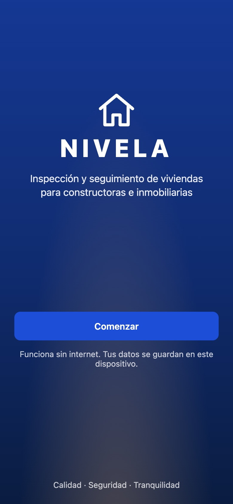<br>Bienvenida | 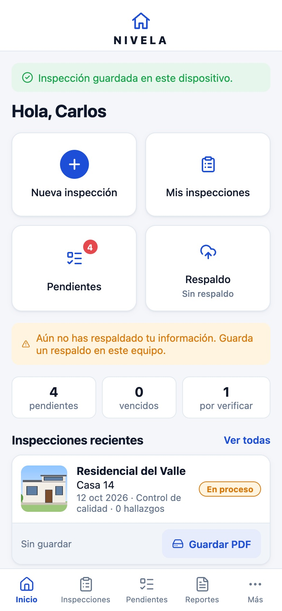<br>Inicio | 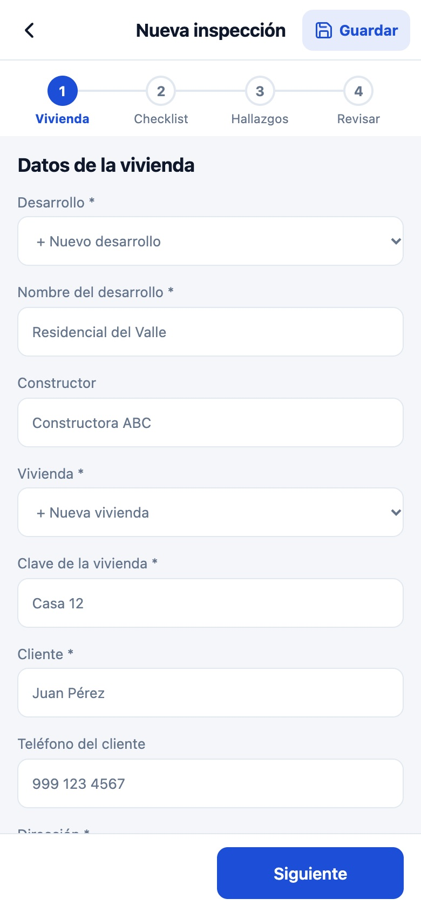<br>Paso 1 · Datos de la vivienda |
| 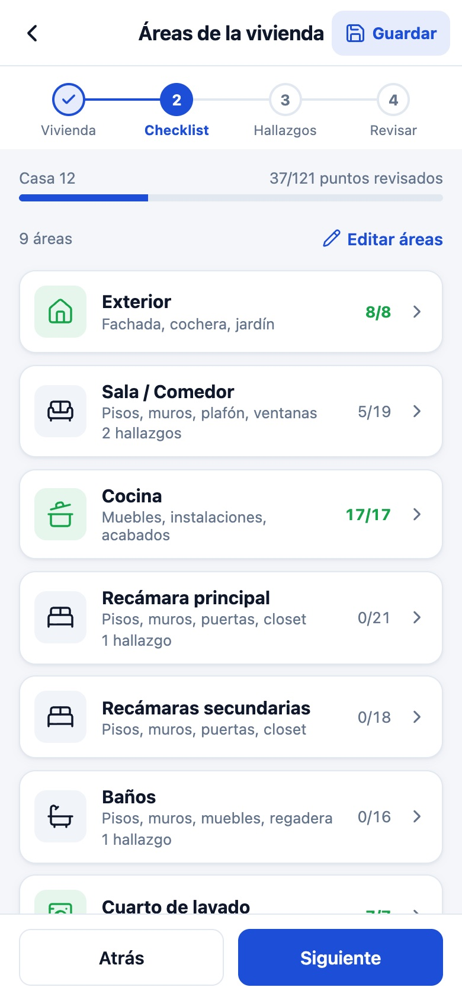<br>Paso 2 · Áreas de la vivienda | 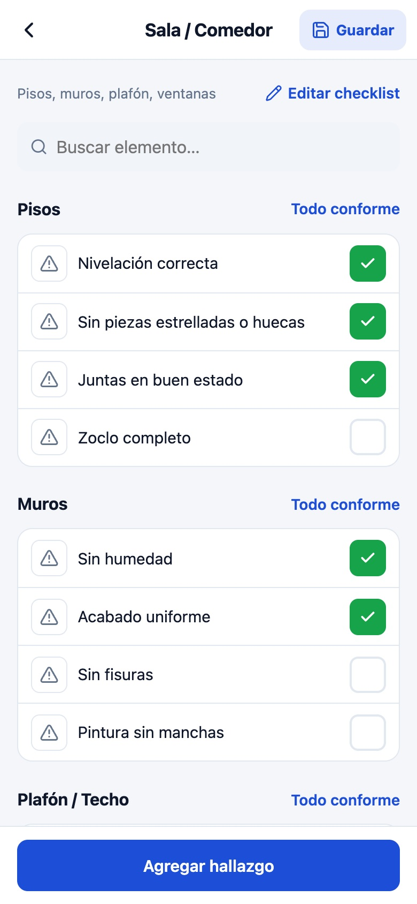<br>Checklist por área | 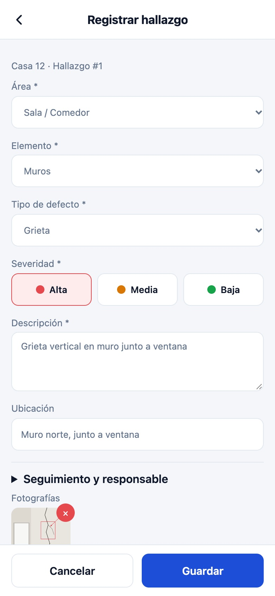<br>Registrar hallazgo |
| 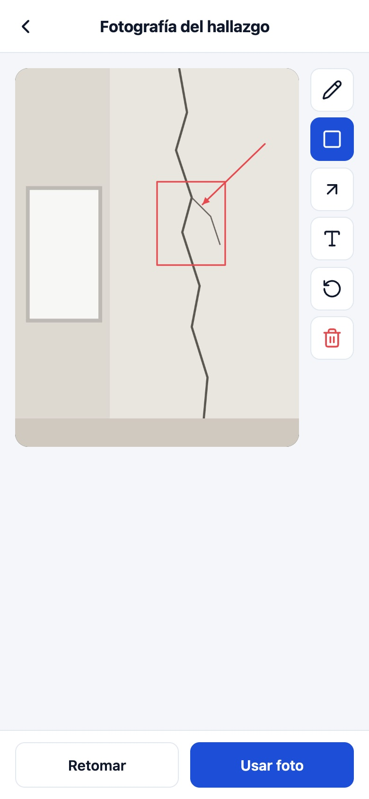<br>Foto anotada | 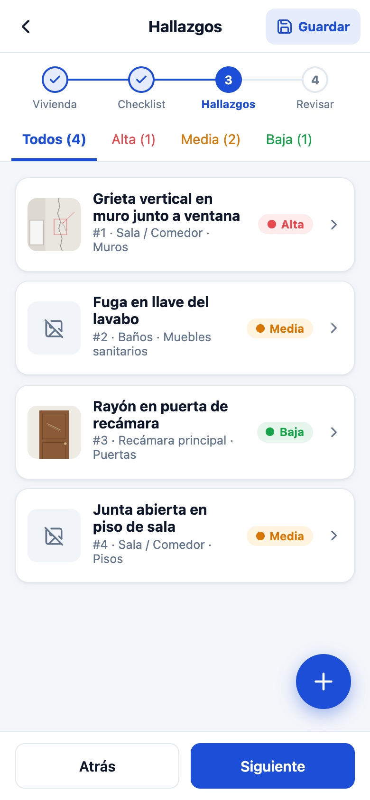<br>Paso 3 · Hallazgos | 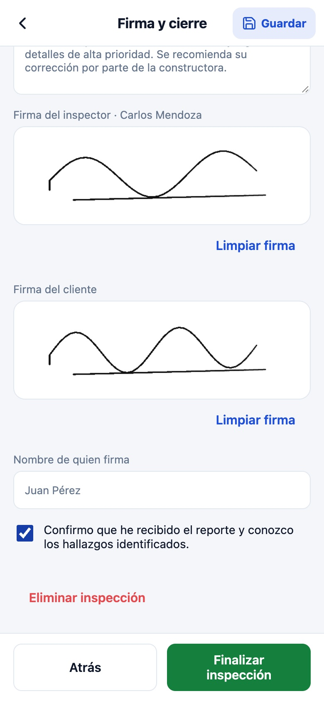<br>Paso 4 · Firma y cierre |
| 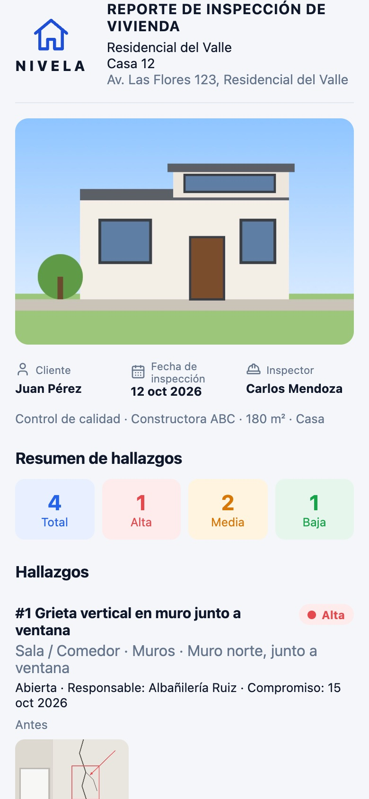<br>Reporte | 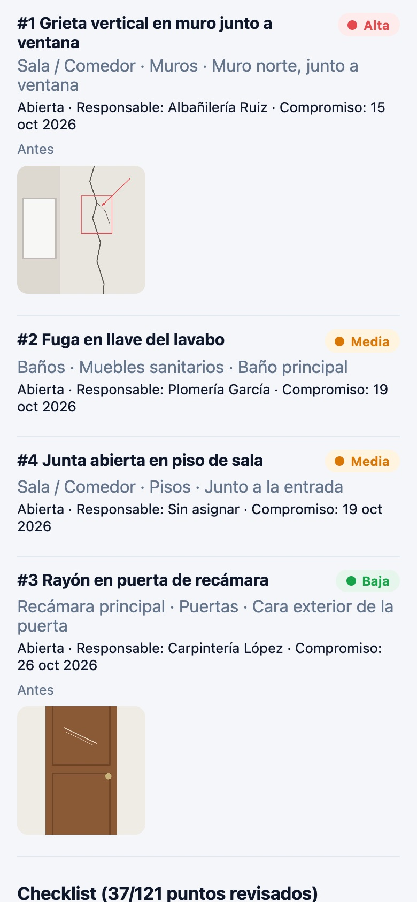<br>Hallazgos del reporte | 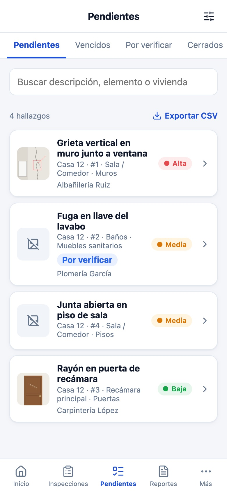<br>Pendientes |
| 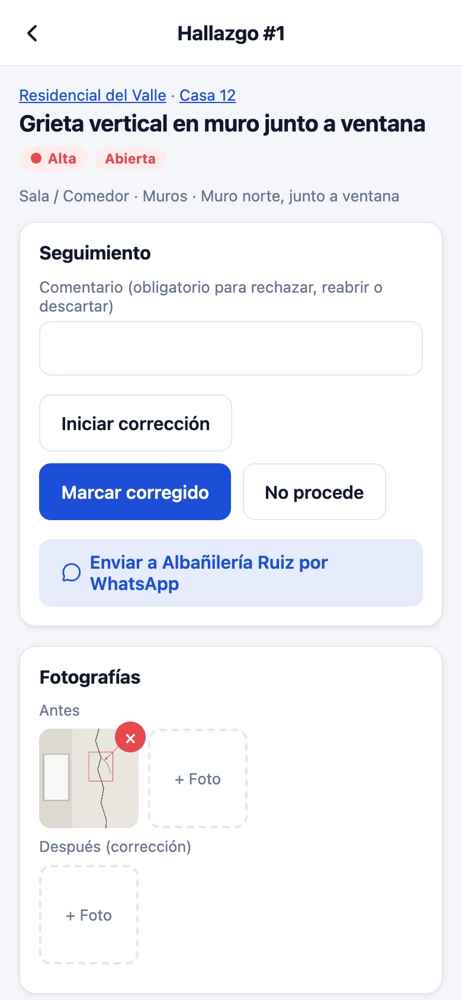<br>Seguimiento del hallazgo | 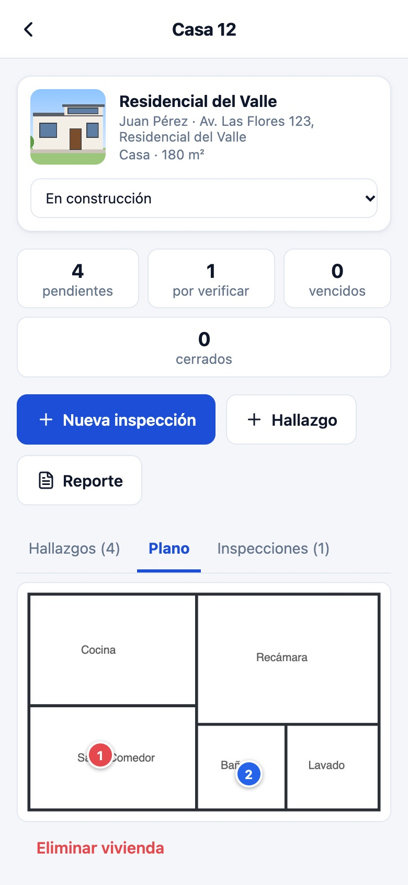<br>Plano con marcas | 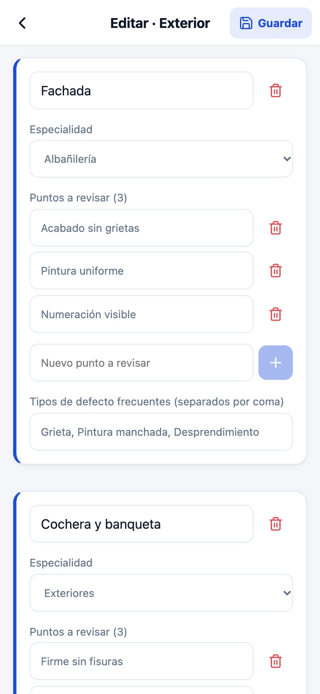<br>Editar checklist |
| 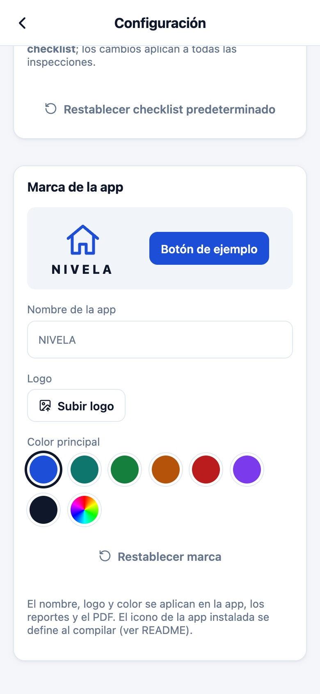<br>Marca configurable | 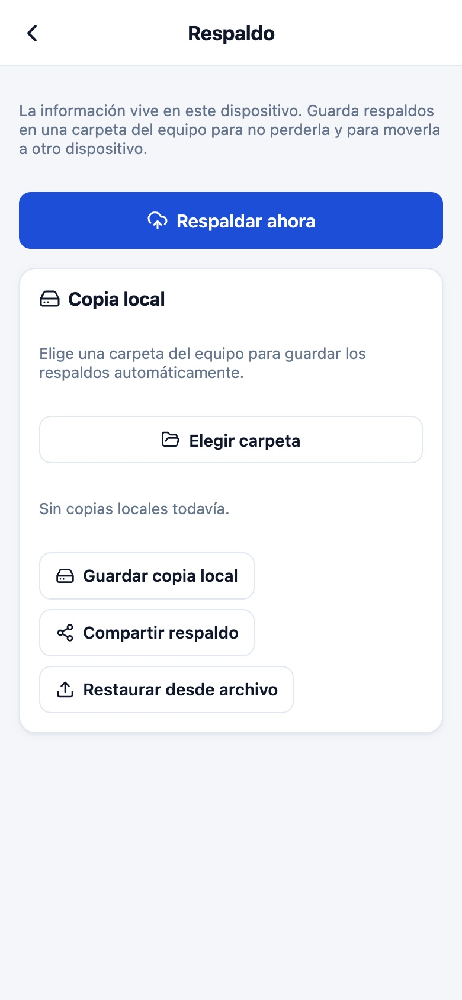<br>Respaldo | 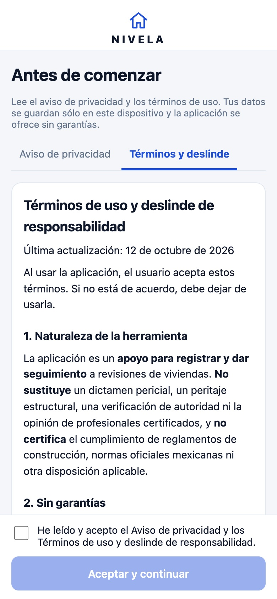<br>Privacidad y términos |

## Funcionalidades

- **Inspección en 4 pasos**: Vivienda → Checklist → Hallazgos → Revisar y firma, con botón **Guardar**
  en cada paso y regreso a **Inicio**.
- **Checklist editable**: agrega, renombra, ordena o elimina áreas, elementos y puntos a revisar, y
  define los tipos de defecto frecuentes. Se guarda en IndexedDB, viaja en el respaldo JSON y se refleja
  en el reporte y el PDF. Cada punto tiene un identificador estable, así que renombrarlo conserva sus
  marcas y hallazgos. Se puede restablecer el predeterminado en **Más → Configuración**.
- **Hallazgos**: área, elemento, tipo de defecto, severidad (Alta / Media / Baja), descripción,
  ubicación y fotografías con **editor de anotaciones** (lápiz, rectángulo, flecha, texto, deshacer).
- **Firmas** del inspector (guardable en el perfil y reutilizable) y del cliente.
- **Seguimiento**: contratista sugerido por especialidad, fecha compromiso según severidad, estados
  Abierto → En corrección → Por verificar → Cerrado, fotos de después, historial, vencidos y WhatsApp.
- **Reporte y PDF real** con marca, fachada, resumen por severidad, hallazgos con fotos, checklist y firmas.
- **Google Drive (opcional):** oculto mientras no se configure `VITE_GOOGLE_CLIENT_ID`; al activarlo,
  cada inspección se sube a su propia subcarpeta (ver *Subir a Google Drive*).
- **Marca configurable**: nombre de la app, logo y color principal (interfaz, reportes y PDF).
- **Pendientes** globales con filtros y CSV; reportes por contratista; desarrollos con planos y alta masiva.
- **Respaldo** JSON en una carpeta local, con restauración desde archivo.

## Stack

React 19 + TypeScript, Vite, Dexie (IndexedDB), React Router (HashRouter), vite-plugin-pwa y Tauri v2.

## Requisitos

- Node.js 20+ y pnpm 9+
- Para la app de escritorio: Rust 1.90+ y los [prerrequisitos de Tauri](https://tauri.app/start/prerequisites/)

## Instalación

```bash
pnpm install
```

## Cómo ejecutar

| Comando | Descripción |
| --- | --- |
| `pnpm dev` | Servidor de desarrollo web en http://localhost:5173 |
| `pnpm build` | Compilación de producción en `dist/` (incluye service worker) |
| `pnpm preview` | Sirve `dist/` localmente para probar la PWA y el modo sin conexión |
| `pnpm tauri:dev` | App de escritorio en modo desarrollo |
| `pnpm tauri:build` | Instaladores de escritorio en `src-tauri/target/release/bundle` |

Para usarla desde un teléfono en la misma red: `pnpm build && pnpm preview --host`. La instalación como PWA
requiere HTTPS o `localhost`; en red local por HTTP la app funciona, pero el navegador no ofrecerá instalarla.

## Variables de entorno

Copia `.env.example` a `.env.local` (ignorado por git) y completa:

| Variable | Descripción |
| --- | --- |
| `VITE_GOOGLE_CLIENT_ID` | ID de cliente OAuth de Google para **Subir a Drive** (ver abajo). Configúralo en Vercel. |
| `VITE_DRIVE_FOLDER_URL` | Carpeta de Drive predeterminada; también se puede cambiar en **Más → Respaldo**. |
| `TAURI_DEV_HOST` | Opcional, solo para desarrollar Tauri en dispositivos móviles. |

## Subir a Google Drive

En la app, cada usuario pega la liga de su carpeta en **Más → Respaldo → Carpeta de Google Drive** y toca
**Subir a Drive** en la tarjeta de la inspección o en el reporte. La primera vez Google pide iniciar sesión y
dar permiso; luego se suben el PDF, la fachada, las fotos y las firmas en una subcarpeta por inspección.

Google no permite escribir en una carpeta sólo con la liga: la app debe estar registrada. Esto lo hace el
dueño **una sola vez** (unos 5 minutos):

1. Entra a [Google Cloud Console](https://console.cloud.google.com/), crea un proyecto y en
   **APIs y servicios → Biblioteca** habilita **Google Drive API**.
2. En **Pantalla de consentimiento de OAuth** elige *Externo*, captura el nombre de la app y tu correo,
   y en **Usuarios de prueba** agrega las cuentas de Google que van a subir archivos (hasta 100).
3. En **Credenciales → Crear credenciales → ID de cliente de OAuth → Aplicación web**, agrega en
   *Orígenes de JavaScript autorizados* la dirección de la app en Vercel (por ejemplo
   `https://app-colecta.vercel.app`) y, para desarrollo, `http://localhost:5173`.
4. Copia el **ID de cliente** y en Vercel ve a **Settings → Environment Variables**: crea
   `VITE_GOOGLE_CLIENT_ID` con ese valor y vuelve a desplegar (**Deployments → Redeploy**).
5. Para desarrollo local, ponlo también en `.env.local`.

La cuenta que inicia sesión debe tener permiso de **edición** sobre la carpeta. Se usa el alcance
`https://www.googleapis.com/auth/drive`; mientras la app esté en modo *Prueba*, sólo las cuentas agregadas
como usuarios de prueba pueden autorizarla. En la app de escritorio (Tauri) el inicio de sesión de Google
no está garantizado; ahí usa la copia local.

**Copia local**: en Chrome y Edge se elige una carpeta del equipo una sola vez y cada respaldo se guarda
ahí con fecha; en otros navegadores el archivo se descarga. Al finalizar una inspección se hace un respaldo
automático a los destinos ya autorizados.

## Estructura

```
src/
  db/          esquema Dexie y migraciones, catálogo de áreas, acciones, ajustes y respaldo
  lib/         Google Drive, copia local, imágenes, CSV, WhatsApp y utilidades
  components/  encabezado, pestañas, pasos, hallazgos, editor de fotos, plano y firma
  pages/       inicio, inspecciones, pendientes, reportes, más, desarrollos y contratistas
  pages/inspection/  pasos del asistente de inspección
  styles/      tokens, pantallas, inspección y reporte
src-tauri/     proyecto Tauri v2
```

## Datos

La información vive solo en el navegador o en la app de escritorio del dispositivo. Borrar los datos del sitio
elimina la base local, por lo que se recomienda exportar respaldos periódicamente desde la sección **Respaldo**.

## Marca e icono instalado

El nombre, logo y color se cambian en **Más → Configuración** y se aplican de inmediato en la app,
los reportes y el PDF. El nombre y el icono que muestra el sistema al **instalar** la PWA o la app de
escritorio se toman al compilar: edita `name`/`short_name` en `vite.config.ts`, reemplaza
`public/icon.svg`, `public/icon-192.png` y `public/icon-512.png`, y regenera los iconos de escritorio con
`pnpm tauri icon <imagen-1024.png>`.
